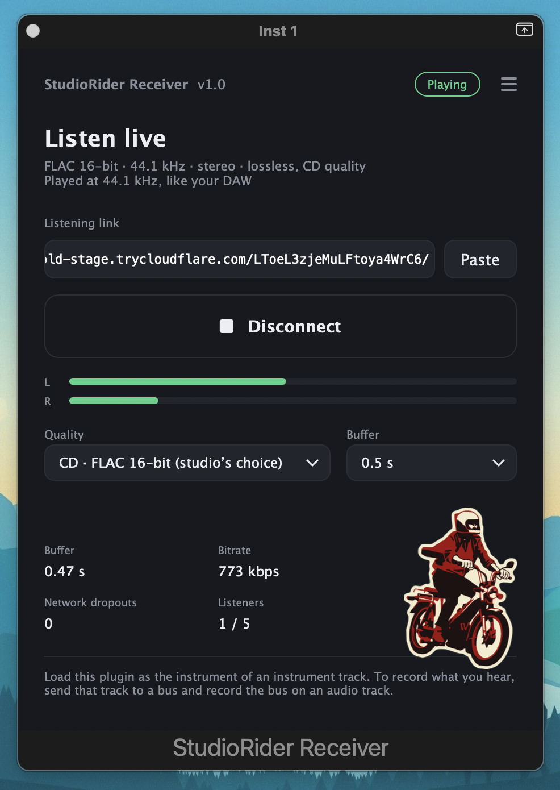

<p align="center">
  
</p>

# StudioRider Receiver

**A companion plugin for [StudioRider](https://github.com/Creme74/StudioRider).
It does nothing on its own: it needs a listening link from StudioRider.**

> **Testing phase.** StudioRider Receiver is still being tested. To date it has
> been tested and works **only in Logic Pro, as an Audio Unit**, on macOS.
> Ableton Live does not work yet (neither as an Audio Unit nor as a VST3), and
> the VST3 version is put aside for now. Other DAWs that load Audio Units are
> untested. Reports are welcome in the [issues](../../issues).

## What it is

[StudioRider](https://github.com/Creme74/StudioRider) is a plugin that a studio
puts on its master track: it shares what the DAW plays through a free public
link, and **the listener only needs a web browser, nothing to install**. That
stays the normal way to listen.

StudioRider Receiver is for the listener who would rather receive that same link
**inside their own DAW**: to hear the studio next to their own tracks, or to
**record** the stream. It is optional, and nothing changes for the studio: it
shares the same link as usual, and the receiver counts as one of its listeners.

```
Studio:    DAW ─► StudioRider ─► public link ─┬─► web browser (nothing to install)
Listener:                                     └─► DAW ─► StudioRider Receiver
```

Without a link from a studio running StudioRider, the receiver has nothing to
play.

<p align="center">
  
</p>

## Requirements

- macOS 13 Ventura or later, Apple Silicon or Intel.
- A DAW that loads Audio Units. Tested: Logic Pro only (see above).
- A StudioRider listening link (StudioRider 1.0 or later, on the studio's side).

## Installing

Download **[StudioRider-Receiver-1.0.pkg](https://github.com/Creme74/StudioRider-Receiver/releases/download/v1.0/StudioRider-Receiver-1.0.pkg)**
and open it (all versions: **[Releases](https://github.com/Creme74/StudioRider-Receiver/releases)**).
It installs, for all users:

| What | Where |
|---|---|
| Audio Unit | `/Library/Audio/Plug-Ins/Components/StudioRider Receiver.component` |
| Uninstaller | `/Applications/StudioRider Receiver/Uninstall StudioRider Receiver.app` |
| Licences | `/Library/Application Support/StudioRider Receiver` |

The installer is not signed with an Apple Developer ID yet, so macOS refuses to
open it the first time:

- macOS 15 and later: open it once, click **Done**, then **System Settings >
  Privacy & Security**, scroll down to the message about StudioRider Receiver and
  click **Open Anyway**.
- macOS 13 and 14: right-click (or Control-click) the `.pkg`, choose **Open**,
  then **Open** again.

If your DAW was open, quit and reopen it.

To uninstall: **Applications > StudioRider Receiver > Uninstall StudioRider
Receiver**. It asks for your password and removes the plugin and itself.
StudioRider (if you also have it) and your projects are not touched.

The installer replaces copies of StudioRider Receiver in your own
`~/Library/Audio/Plug-Ins` folder (made with `build.sh`), so the DAW doesn't see
the plugin twice. To build it yourself instead, see [Building](#building).

## Using it (Logic Pro)

1. Ask the studio for its StudioRider link (it changes each time the studio
   starts sharing).
2. Create a **software instrument track** and load **StudioRider Receiver** as
   its instrument: it is listed under **AU MIDI-controlled Effects** (it ignores
   MIDI).
3. Paste the link (**Paste**), then click **Connect**. The window shows the
   format, the buffer, the bitrate and the level.
4. To record what you hear, send that track to a bus and record the bus on an
   audio track.

Why an instrument track: Logic Pro doesn't run an effect on an audio or aux track
that carries no sound, to save CPU. The receiver's input is always silent (its
sound comes from the network), so there it would never be asked for audio. An
instrument track is always run. If the plugin isn't run, its window says **Not
processed**, and its meters still show the sound that arrives.

**Quality** works as on StudioRider's listening page: the studio's choice by
default, or a lighter quality; the studio never sends more than its own setting.
**Buffer** is the delay kept against network hiccups (0.5 s by default). The
sound comes out at 100 % (no volume control in the plugin: use the track's
fader), converted to the DAW's sample rate. The two machines' clocks never run at
exactly the same speed: the receiver follows the difference (a few dozen ppm,
inaudible), so the buffer neither empties nor fills up over time.

The link is saved with the project, but opening a project never connects by
itself. If the studio stops sharing, the receiver says so; if the connection
drops, it reconnects on its own and gives up after 2 minutes. A StudioRider link
accepts 5 listeners at a time, browsers and receivers together.

## How it works

- `Source/ReceiverEngine.*` (no JUCE): connection and reconnection, decoding and
  resampling on the network thread, a lock-free buffer read by the audio thread,
  clock-drift correction.
- `Source/StreamDecoder.*`: StudioRider's audio messages (`MXS2`): FLAC
  16/24-bit frames (libFLAC) or Opus packets (libopus).
- `Source/Resampler.*`: windowed-sinc resampler (about 120 dB SNR) whose ratio
  can be nudged by the ppm without clicks.
- `Source/WebSocketClient*`: macOS `NSURLSessionWebSocketTask` (wss://, system
  TLS and proxies); a plain `ws://` client elsewhere (used by the tests).
- `Source/ReceiverProcessor.*`, `Source/ReceiverEditor.*`: the JUCE plugin and
  its window (same look as StudioRider's listening page).

## Building

On a Mac with Apple's Command Line Tools (`xcode-select --install`): double-click
**Build StudioRider Receiver.command**, or run `./build.sh`, to build it for this
Mac and install it in your own `~/Library/Audio/Plug-Ins`. To make the installer
(universal, Apple Silicon + Intel), double-click **Make StudioRider Receiver
Installer.command**, or run `./package.sh`: it writes
`build/StudioRider-Receiver-<version>.pkg` and the matching source archive. It downloads JUCE,
libFLAC and libopus at the versions pinned in `scripts/common.sh` (CMake is
installed with Homebrew if missing). The VST3 can still be built for testing
(`-DSTUDIORIDER_RECEIVER_VST3=ON`), but it doesn't work yet.

Tests (macOS or Linux): `scripts/run_tests.sh` (on Linux, `xvfb-run
scripts/run_tests.sh`). They download StudioRider's sources and run its real
server: FLAC bit-exactness, Opus, resampling quality, clock drift, quality
changes, full studio, expired link, "Stop sharing", saved state, "Not
processed", and screenshots of the window in `build/screenshots`. They can't
tell what a real DAW does with the plugin: that is what the testing phase is for.

## Licence

GNU General Public License, version 3 or later: see [LICENSE](LICENSE). Third-party
software and licences: [THIRD_PARTY_NOTICES.md](THIRD_PARTY_NOTICES.md).
Logic Pro and Audio Units are trademarks of Apple Inc.; Ableton Live is a
trademark of Ableton AG. StudioRider Receiver is not affiliated with them.
